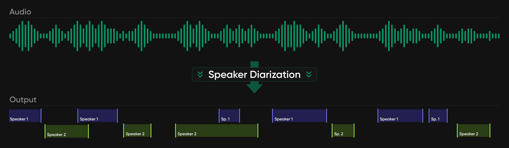

## 💚 Simply detect, segment, label, and separate speakers in any language 

<div align="center">
  <a href="https://github.com/pyannote/pyannote-audio"></a>
  <a href="https://hf.co/pyannote"></a>
  <a href="https://discord.gg/vux8UH9QmV"></a>
  <a href="https://www.linkedin.com/company/pyannoteai/"></a>
  <a href="https://x.com/pyannoteAI"></a><br/>
  <a href="https://dashboard.pyannote.ai/"></a> 
  <a href="https://docs.pyannote.ai/"></a> 

</div>

[pyannoteAI](https://www.pyannote.ai/) facilitates the understanding of speakers and conversation context. We focus on identifying speakers and conversation metadata under conditions that reflect real conversations rather than controlled recordings.

### 🎤 What is speaker diarization?



**Speaker diarization** is the process of automatically partitioning the audio recording of a conversation into segments and labeling them by speaker, answering the question **"who spoke when?"**. As the **foundational layer of conversational AI**, speaker diarization provides high-level insights for human-human and human-machine conversations, and unlocks a wide range of downstream applications: meeting transcription, call center analytics, voice agents, video dubbing.

### ▶️ Getting started

Install [`pyannote.audio`](https://github.com/pyannote/pyannote-audio) latest release available from  with either `uv` (recommended) or `pip`:

```bash
$ uv add pyannote.audio
$ pip install pyannote.audio
```

Enjoy state-of-the-art speaker diarization:

```python
# download pretrained pipeline from Huggingface
from pyannote.audio import Pipeline
pipeline = Pipeline.from_pretrained('pyannote/speaker-diarization-community-1', token="HUGGINGFACE_TOKEN")

# perform speaker diarization locally
output = pipeline('/path/to/audio.wav')

# enjoy state-of-the-art speaker diarization
for turn, speaker in output.speaker_diarization:
    print(f"{speaker} speaks between t={turn.start}s and t={turn.end}s")
```

Read [`community-1` model card](https://hf.co/pyannote/speaker-diarization-community-1) to make the most of it.


### 🏆 State-of-the-art models

[`pyannoteAI`](https://www.pyannote.ai/) research team trains cutting-edge speaker diarization models, thanks to [**Jean Zay**](http://www.idris.fr/eng/jean-zay/) 🇫🇷 supercomputer managed by [**GENCI**](https://www.genci.fr/) 💚. They come in two flavors:

* [`pyannote.audio`](https://github.com/pyannote/pyannote-audio) open models available on [Huggingface](https://hf.co/pyannote) and used by 140k+ developers over the world ;
* premium models available on [`pyannoteAI` cloud](https://dashboard.pyannote.ai) (and on-premise for enterprise customers) that provide state-of-the-art speaker diarization as well as additional enterprise features.

| Benchmark (last updated in 2025-09) | <a href="https://hf.co/pyannote/speaker-diarization-3.1">`legacy` (3.1)</a>| <a href="https://hf.co/pyannote/speaker-diarization-community-1">`community-1`</a> | <a href="https://docs.pyannote.ai">`precision-2`</a> | 
| --------------------------------------------------------------------------------------------------------------------------- | ------------------------------------------------------ | -------------------------------------------------| ------------------------------------------------ |
| [AISHELL-4](https://arxiv.org/abs/2104.03603)                                                                               | 12.2 | 11.7 | 11.4 🏆 |
| [AliMeeting](https://www.openslr.org/119/) (channel 1)                                                                      | 24.5 | 20.3 | 15.2 🏆|
| [AMI](https://groups.inf.ed.ac.uk/ami/corpus/) (IHM)                                                                        | 18.8 | 17.0 | 12.9 🏆|
| [AMI](https://groups.inf.ed.ac.uk/ami/corpus/) (SDM)                                                                        | 22.7 | 19.9 | 15.6 🏆 |
| [AVA-AVD](https://arxiv.org/abs/2111.14448)                                                                                 | 49.7 | 44.6 | 37.1 🏆 |
| [CALLHOME](https://catalog.ldc.upenn.edu/LDC2001S97) ([part 2](https://github.com/BUTSpeechFIT/CALLHOME_sublists/issues/1)) | 28.5 | 26.7 | 16.6 🏆 |
| [DIHARD 3](https://catalog.ldc.upenn.edu/LDC2022S14) ([full](https://arxiv.org/abs/2012.01477))                             | 21.4 | 20.2 | 14.7 🏆 |
| [Ego4D](https://arxiv.org/abs/2110.07058) (dev.)                                                                            | 51.2 | 46.8 | 39.0 🏆 |
| [MSDWild](https://github.com/X-LANCE/MSDWILD)                                                                               | 25.4 | 22.8 | 17.3 🏆 |
| [RAMC](https://www.openslr.org/123/)                                                                                        | 22.2 | 20.8 | 10.5 🏆 |
| [REPERE](https://www.islrn.org/resources/360-758-359-485-0/) (phase2)                                                       | 7.9  |  8.9 |  7.4 🏆 |
| [VoxConverse](https://github.com/joonson/voxconverse) (v0.3)                                                                | 11.2 | 11.2 |  8.5 🏆 |

__[Diarization error rate](http://pyannote.github.io/pyannote-metrics/reference.html#diarization) (in %, the lower, the better)__

Our models achieve competitive performance across multiple public diarization datasets, explore pyannoteAI performance benchmark ➡️ [https://www.pyannote.ai/benchmark](https://www.pyannote.ai/benchmark)

[`precision-3`](https://www.pyannote.ai/blog/precision-3) is our latest paid model: **14.35 DER against `precision-2`'s 16.02**, averaged over 15 benchmark datasets, a 10.4% relative reduction. Over half of that gain comes from better speaker attribution, with speech assigned to the wrong speaker 18.7% less often. Full per-dataset results, including against `community-1`, are in the [`precision-3` benchmarks post](https://www.pyannote.ai/blog/precision-3-benchmarks).

### ⏩️ Going further, better, and faster

[`precision-2`](https://www.pyannote.ai/blog/precision-2) premium model further improves accuracy, processing speed, as well as brings additional features.

| Features | <a href="https://hf.co/pyannote/speaker-diarization-community-1">`community-1`</a> | <a href="https://docs.pyannote.ai">`precision-2`</a> | <a href="https://www.pyannote.ai/blog/precision-3">`precision-3`</a> |
| -------------- | ----------- | ----------- | ----------- |
| Set exact/min/max number of speakers | ✅ | ✅ | ✅ |
| Exclusive speaker diarization (for transcription) | ✅ | ✅ | ✅ |
| Segmentation confidence scores | ❌ | ✅ | ✅ ¹ |
| Speaker confidence scores | ❌ | ✅ | ✅ |
| Voiceprinting | ❌ | ✅ | ✅ |
| Speaker identification | ❌ | ✅ | ✅ |
| STT Orchestration | ❌ | ✅ | ² |
| VAD & cross-talk sensitivity controls | ❌ | ❌ | ✅ |
| Frame-level speech / cross-talk / speaker probabilities | ❌ | ❌ | ✅ |
| Speed / balance / accuracy operating modes (on-prem) | ❌ | ❌ | ✅ |
| Time to process 1h of audio (on H100) | 37s | 14s | ³ |

<sub>¹ In `precision-3` the frame-level segmentation `confidence` output is superseded by `speechProbability`, `crosstalkProbability` and `speakerProbability`. `turnLevelConfidence` is unchanged.</sub>

<!-- TODO before opening the PR:
     ² STT Orchestration on precision-3 is UNCONFIRMED. The API docs currently state that transcription is
       "only available for the precision-2 diarization model", and the 31 Aug decision was to keep the
       precision-2 config for STT until precision-3 is the only model. Confirm with Antoine/Shen whether
       `transcription: true` works with `model: precision-3`, then set this cell.
     ³ No H100 figure exists for precision-3. Published timings are B200 (accuracy 3.05s / balance 1.43s /
       speed 0.97s per hour of audio). Get an H100 number from engineering or split this row by GPU.
       Do NOT put a B200 number into an H100 row.
     Also confirm the precision-3 cells for Voiceprinting and Speaker identification. -->


Create a [`pyannoteAI`](https://dashboard.pyannote.ai) account, change one line of code, and enjoy free cloud credits to try [`precision-2`](https://pyannote.ai/blog/precision-2) premium diarization:

```python
# perform premium speaker diarization on pyannoteAI cloud
pipeline = Pipeline.from_pretrained('pyannote/speaker-diarization-precision-2', token="PYANNOTEAI_API_KEY")
better_output = pipeline('/path/to/audio.wav')
```
### 🎛️ `precision-3`: the same diarization, now tunable

[`precision-3`](https://www.pyannote.ai/blog/precision-3) is the most accurate model we have shipped, and the first to expose the machinery behind its decision, at the same price as [`precision-2`](https://www.pyannote.ai/blog/precision-2).

Two sensitivity parameters bias the model toward the error type you care about:

| Parameter | Range | Effect |
| -------------- | ----------- | ----------- |
| `vadSensitivity` | -5.0 to 5.0, default 0 | Adjusts voice activity detection sensitivity |
| `crosstalkSensitivity` | -5.0 to 5.0, default 0 | Adjusts overlap and cross-talk sensitivity |

Three frame-level probabilities let your own product logic make the call:

| Output | What it answers |
| -------------- | ----------- |
| `speakerProbability` | How likely it is that this specific speaker is active on this frame |
| `crosstalkProbability` | How likely it is that there is cross-talk on this frame |
| `speechProbability` | How likely it is that there is speech on this frame |

```python
# perform premium speaker diarization on pyannoteAI cloud
pipeline = Pipeline.from_pretrained('pyannote/speaker-diarization-precision-3', token="PYANNOTEAI_API_KEY")
better_output = pipeline('/path/to/audio.wav')
```

On the API, set `"model": "precision-3"` in a diarization request. Existing integrations keep working unchanged, and the new parameters and outputs are opt-in. On-premises deployments additionally pick an operating mode per deployment: `accuracy`, `balance`, or `speed`.

<!-- BLOCKER: the snippet above will fail until the HF repo pyannote/speaker-diarization-precision-3 exists.
     As of this branch only pyannote/speaker-diarization-precision-2 is published. Create the precision-3
     model repo (same short-stub shape as the precision-2 card) BEFORE this README goes live. -->

### 🔌 Get speaker-attributed transcripts

We host open-source transcription models like [**Nvidia Parakeet-tdt-0.6b-v3**](https://huggingface.co/nvidia/parakeet-tdt-0.6b-v3) and [**OpenAI whisper-large-v3-turbo**](https://huggingface.co/dropbox-dash/faster-whisper-large-v3-turbo) with specialized STT + diarization reconciliation logic for speaker-attributed transcripts.

STT orchestration orchestrates pyannoteAI diarization `Precision-2` with transcription services. Instead of running diarization and transcription separately, then reconciling outputs manually, you make one API call and receive speaker-attributed transcripts.


To use this feature, make a request to the diarize API endpoint with the `transcription:true` flag.

```python
# pip install pyannoteai-sdk

from pyannoteai.sdk import Client
client = Client("your-api-key")

job_id = client.diarize(
	"[https://www.example/audio.wav](https://www.example/audio.wav)",
	transcription=True)

job_output = client.retrieve(job_id)

for word in job_output['output']['wordLevelTranscription']:
	print(word['start'], word['end'], word['speaker'], word['text'])

for turn in job_output['output']['turnLevelTranscription']:
	print(turn['start'], turn['end'], turn['speaker'], turn['text'])

